# Task document format

Load this file twice on a cut: once at the sweep, for the canonical nine-dimension rubric below ([cut.md](cut.md) § Sweep the nine sends you here), and once at the write step, for the template. Nothing here is needed while cutting slices or grounding them in the code.

Section headings are fixed — the next skill finds sections by their exact names. Everything else adapts: prose is written in the document's own language, while identifiers keep the system's spelling and are never translated. A person is the first reader; after that, `verified-implementation` converts the criteria into checks, and whatever sits under `Unresolved` stays undecided throughout the build.

Each placeholder becomes a concrete value, or its section is removed. A heading followed only by "N/A" never ships.

## Canonical rubric: the nine unwritten-requirement dimensions

The sweep has one owner: this list. Every other skill that sweeps — `specify` in this same pipeline, `verified-implementation` — points here instead of restating the keys, so a dimension added or renamed here reaches every sweep at once. Walk all nine, every time, in this order.

| Dimension | What to cover |
| --- | --- |
| validation | Input limits, formats, sanitization, bounds |
| failure modes | Timeouts, partial saves, rollbacks, partial-failure states |
| idempotency and retry | Safe retries, dedup keys, duplicate handling |
| authorization | Who may call what, auth boundaries, rate limits |
| concurrency and ordering | Race conditions, ordering guarantees |
| data lifecycle | TTL, archival, expiry, deletion |
| external-dependency failure | Circuit breakers, fallbacks, dependency outages |
| state transitions | Valid transitions, guards, integrity |
| observability | Logging, metrics, tracing hooks |

Every dimension gets exactly one of four landings, and `n/a` is a real answer that must be given, not a way to skip:

- the number of a criterion already written for that dimension
- `existing - <what in the code already covers it>`
- `n/a - <reason>` — for example, a webhook cannot have an empty state; one line says so
- `Unresolved <n>` — when covering it would need behaviour nobody specified, it is a question and never a numbered line

A landing only counts if it observes its own dimension. Reusing a criterion number that already backs a different line means the dimension is uncovered. Of the nine, concurrency and observability are the easiest to overlook.

## Template

Write `.tasks/<name>.md`, one file per task:

````markdown
# <Title>

> Build with **verified-implementation** (`<repo-relative path, when the project vendors the skill>`).
> Every numbered criterion turns into a check with a proof, cited by that number. Questions under
> `Unresolved` stay open for the whole build.

## Intent

<Problem, present tense, solution-free: the current state that is wrong, who is hurt by it, and
what it costs them. Bring over any evidence the source offers.>

<Change: what a user notices once this ships. For interface work, name the screen and the flow and
link the design - it counts as a source in its own right.>

<N criteria in M slices · K one-way doors · Q open, of which B block>

## Criteria

One observable outcome per line, value included; add the precondition when the outcome hinges on
one. A screen gets one line per state that matters - empty, loading, error, unauthorised - each
naming the screen the design assigns to it. Use the shape the criterion really has: When/Then fits
most, and the five shapes below are there to pick from, not to fill. Slices are the headings, and
numbers continue across the whole task.

### <slice - the outcome someone can watch> · <files> files · <KB> KB · ~<tokens>k

1. Given <state>, when <trigger>, then <observable outcome with the concrete value>.
2. When <trigger>, then <observable outcome>.

### <slice> · <files> files · <KB> KB · ~<tokens>k

3. While <state holds>, <observable outcome>.
4. If <condition goes wrong>, then <observable outcome>.
5. Always, <invariant with the concrete value>.

## States

Include only when the task changes a lifecycle; label every edge with the criterion number behind it.

```mermaid
stateDiagram-v2
    <From> --> <To>: <trigger> (<criterion number>)
    <ExistingState> --> <ExistingState>: <unchanged - label as existing>
```



## Out of scope

- <excluded capability> - <why>

## Observable

One row per item, for every surface the task exposes. Landings are a written criterion, `existing`, `n/a` or `Unresolved` - nothing the walk invented.

| Surface | Decision | Landing |
| --- | --- | --- |
| screen `<name>` | empty state | 1 |
| screen `<name>` | error state | Unresolved 2 |
| screen `<name>` | destructive action confirms | existing - <the pattern already in use> |
| API `<METHOD> /<path>` | error shape and codes | n/a - <why it does not apply> |

<Or:> `None - no user-facing surface`

## Swept

All nine dimensions on every task, one line each, showing where each unwritten requirement landed.

- validation: <criterion number>
- failure modes: <criterion number>
- idempotency and retry: <criterion number>
- authorization: existing - <the guard or policy that already covers this>
- concurrency and ordering: <criterion number>
- data lifecycle: n/a - <why it does not apply>
- external-dependency failure: <criterion number>
- state transitions: <criterion number>
- observability: Unresolved <number>

## Impact

Existing things this change disturbs. "Nothing" is a fine answer; a row left out is not.

| Front | What changes |
|---|---|
| domain | new term: `<Name>` - <one-line definition>, lives in <module> |
| domain | existing term: `<Name>` meant <x>, now means <y> - <who branches on it today> |
| stored data | <backfill now / migrate on read / dual write / nothing to migrate> |

## Decided

Hard-to-reverse choices only, each in its literal shape. A single row
`None - <why nothing here is one-way>` is acceptable.

| Decision | Shape | Alternative rejected |
|---|---|---|
| <what was decided> | <schema, endpoint + body, enum value, event payload, dependency> | <the option and the property that disqualified it> |

## Relations

Include only when the shape of stored data changes, and draw only what `Decided` settled:
entities, cardinality, one-way constraints. No columns, no types.

```mermaid
erDiagram
    <Entity> ||--o{ <Entity> : <verb>
    <Entity> ||--|| <Entity> : "<verb> - unique, decision <row>"
```

## Surface

Include only when the task adds or changes an interface consumed from outside it. Signature only,
not a specification.

| Route | In | Out | Status | Criteria |
|---|---|---|---|---|
| `<METHOD> /<path>` | `<field>`, `<field>` | `<field>`, `<field>` | `<code>`, `<code>` | <numbers> |

## Sources

- <link> - <what it settles>
- <design> - **binding for the interface**: screens <ids>, and where the copy lives

This task is the record of decision. Where a linked document disagrees with it, ask before building.

## Unresolved

What the source leaves open and asking could not settle. Nothing here gets filled in during the
build. With nothing open, write one row whose Question is `None` and leave the other cells empty;
omitting the section does not count as an answer.

| # | Kind | Question | Until answered |
|---|---|---|---|
| 1 | blocks | <question> | <which criterion cannot be satisfied until it is answered> |
| 2 | blocks go-live | <question> | <what cannot be switched on for real users until it is answered> |
| 3 | open | <question> | <what stays imprecise, and what was written in the meantime> |
````

**Handoff line.** Whoever opens the file usually received only its path — more and more often an agent who never saw the conversation behind it. So the first line does two jobs. It tells that reader which skill converts criteria into checks, because the document holds no plan on purpose and a reader left to improvise will make one up. And it restates the rule most often broken when time is short: an open question gives nobody licence to decide it. Refer to the skill by name, not by location — install locations vary per repository, and a dead link trains readers to ignore the line. Only when the project vendors the skill inside the repository, put its repo-relative path next to the name as a fallback: a skill set to explicit invocation only is missing from an agent's skill list, and a headless or cloud run cannot act on a bare name. Never write a path under anyone's home directory; those rot first.

**Intent: two paragraphs, two questions.** Ask "what is wrong?" and "what changes?" in one go and only the change comes back. The change is free — the source already states it. The problem has to be recovered and is the part that usually goes missing, so it gets a paragraph of its own where its absence is obvious.

The problem paragraph describes the present and proposes nothing. Naming a missing solution — "we have no Stripe integration" — is not a problem; it only restates this task's answer and can never argue for anything else. A problem names a current state that is wrong, who suffers it and at what cost: "evaluators have to hand over a card before they can try anything" is something a reader could dispute, and being disputable is what makes it a real claim. Bring the source's evidence across verbatim — figures, ticket volumes, dates set by someone else. When there is none, say there is none instead of inventing urgency.

A source with no stated problem has a gap like any other, so ask. The question does not block, since the criteria hold without it, but work nobody can justify is the work most likely to be wrong. And without a stated end, a reviewer can only check that `Decided` argues coherently about means — never that the task is the right one.

**Criteria.**

- They are numbered because proofs, review comments and questions all point at them by number.
- Each line holds a single outcome, not a single assertion. A single outcome usually has several visible facets: a trial that ends up `Trialing`, populates `trialEndsAt` and creates the provider-side subscription is still one criterion. Split a line only when it holds two triggers, or two outcomes that could pass or fail separately; an "and" on its own is no reason. Breaking facets into separately provable checks happens in the next skill, where each check carries exactly one proof.
- Use Given only when a precondition changes the result; otherwise a plain When reads better.
- Three kinds of criterion have no trigger. Give each its own shape rather than bending it into When/Then:
  - `Always` — an invariant ("a paused subscription never grants access"); pinning it to an invented moment changes what it claims.
  - `While` — true across a period rather than at an instant ("while the trial runs, usage is recorded but not billed").
  - `If` — a reaction to something failing rather than to someone acting ("if the provider stays silent for 10s, the charge is not retried").

  Squeezed into a When, these end up as a trailing clause of some other criterion — the usual place where invariants and failure handling get lost.
- **Connectives follow the task's language.** They are shapes, not syntax, and nothing parses them, so a Portuguese task uses `Dado`, `Quando`, `Então`; switching languages mid-sentence only slows the reader down. Three tiers apply, and only the middle one varies: section headings never change, because this skill and the next both look them up by name; prose and connectives follow the document; identifiers keep the system's spelling — status values, fields, routes, HTTP codes, class names. A translated `Trialing` describes a system that is not there.
- Slice headings are the slices the cut produced. Flattening them into one list hides where one behaviour (starting a trial) stops and the next (cancelling it) starts, and it throws away seams that are already drawn for anyone who later asks how to split. **Numbering runs through the whole task and never restarts under a heading** — a number repeated under three headings is worse than having no groups. Below roughly six criteria, drop the headings: the whole list fits in view.

**A heading carries the slice's weight** - files touched, the `wc -c` byte count over them, the token estimate - because ranking slices by weight is the decision, and the weight on the page is what makes an over-large slice visible without a file-count ceiling that splits one observable outcome into pieces nobody can verify alone. The arithmetic belongs to `verified-implementation`'s checklist format, which copies these headings into its checks.

**Status line.** It closes `Intent` so that the file, like the chat, opens with its verdict. In a few seconds a reviewer chooses between reading now and sending the task back, based on three facts — how large the work is, how much of it is fixed, how much remains undecided — that would otherwise be spread over three sections, one of them at the very bottom. Give counts, never adjectives: "4 open, 1 blocks go-live" is actionable; "mostly settled" is not.

**Testability.** Every criterion gets a proof downstream; if nobody can say which test would prove it, it is not ready to be written. Do not name the test here, though — that needs the repository's actual test setup, which is the next skill's work.

**States.** A list of criteria is poor at expressing a lifecycle: each transition can read correctly while the machine as a whole appears nowhere, so the state with no way out goes unnoticed precisely where it hurts most. Draw the diagram only for a task that changes a lifecycle, and derive it **from** the criteria — every edge carries its criterion number, and an edge you would like but cannot number points at a gap: close the gap rather than adding the edge as fact. That derivation rule is the entire safeguard; drop it and the diagram turns into an opinionated design document that drifts out of date and misleads. Show the existing states that are not changing as well, marked existing — the risky edge tends to sit between new and old.

The derivation rule is also the filter for diagrams in general: it lets `Relations` and `Surface` in and keeps every other picture out. Component maps and call sequences are design. Nothing in the task backs them, so nothing keeps them true and they are the first to drift — and one drawn without reading the code invents components that look settled simply because someone drew them. A call sequence that genuinely matters is a one-way door: put its literal shape in `Decided`. If tasks live in a tracker, confirm it renders mermaid before adopting it; raw mermaid is readable, though barely.

**Impact.** The rows are fixed because the risk is omission, not vagueness: a missing section reads as "nothing to say", while an empty row reads as an unanswered question.

- The domain rows deserve more care than they seem to. Names propagate into classes, columns, payload keys and routes, and renaming one later means a migration plus every consumer — naming is a one-way door in disguise. A new term gets a one-line definition and its home. A term that changes meaning must name **who branches on it today**: those callers are outside the feature's diff, so this is where silent breakage gets caught.
- With more than two terms, give each its own `domain` row. A cell holding six terms separated by punctuation cannot reveal a gap, and revealing gaps is the table's only purpose.
- The stored-data row covers whatever executes against existing rows, not only the data you move. Adding a constraint to a table that already has rows makes the outcome depend on those rows: a unique index on a column that was never unique breaks on the first existing duplicate — in production, on real data, not on the three fixtures in a test. "Nothing to migrate" answers the other half. Spell out what has to be true before the migration runs.

**Decided.**

- It holds: a persisted schema, a contract another party consumes, a new dependency, a data backfill, or a pattern new to the codebase — a precedent becomes irreversible once later features copy it.
- Each row gives the literal shape someone will copy, plus the rejected alternative and the property that ruled it out. "Cleaner" cannot be disputed; "cannot express the next state" can. If the choice was forced, name the constraint that forced it; if two options were genuinely in play, give each a row.
- Judge every rejection against later work, not only this task. A constraint that fixes today's problem can forbid a future slice: a uniqueness rule added to stop abuse also means no user can ever own a second row — something the eventual builder of renewals will care about, and something the anti-abuse reasoning never raised. When a door reaches beyond the boundary, write down what it closes; that sentence is the point of the review.
- Two things look like decisions and are not, and admitting them turns the table into a dumping ground. Scope ("V1 does not charge") reverses by shipping the next slice and already lives in `Out of scope`. A rule with nothing enforcing it ("one trial per user") reverses by changing a condition; it turns into a door only when persisted state enforces it, and at that point the row records the unique index itself, in its literal definition, not the rule.
- Columns and types qualify when they are doors — the cue is never the word "column". Identifier width is formally a type yet irreversible once there is volume, because it does not get migrated. Uniqueness is a product decision, not just a storage one. Changing nullability where rows already exist is a migration whose success depends on those rows. Once a consumer binds to a field, renaming it is no longer your call. Names, indexes and ordinary types are settled by the implementer from the repository's conventions; settling them here means deciding without reading the code that has to hold them. A data choice that needs argument rather than a row — partitioning, denormalising, switching stores — is RFC material.
- A decision that needs a paragraph of justification, or several doors arriving together, calls for an RFC written **before** the task. Link the RFC from the row, and keep the row's shape literal.

**Relations.** It pictures what `Decided` already settled and settles nothing itself. Its only justification is that cardinality is clearer drawn than written: `1 --> 1` versus `1 --> *` decides whether a user may ever hold a second subscription, and inside a decision row a reviewer skims past it where a diagram would show it at once.

Draw only entities, cardinality and one-way constraints — and above all no columns. A complete diagram looks authoritative and gets built exactly as drawn, so the eighty percent the planner guessed without opening the code arrives disguised as decisions. An invented schema dressed as a decision is worse than leaving the diagram out, since no one questions it. Each relationship must trace to a `Decided` row; one that does not is a decision nobody took.

**Surface.** The same idea, applied to an interface, whose shape falls apart when scattered. Spread route, method, inputs, outputs and statuses across eight criteria and they are all present yet none is legible — and a missing status has nowhere to show. In one table the gap is an empty cell. Each row cites its criteria, so the table projects them instead of competing with them as a second source.

Keep it to the signature. Types, examples and an error catalogue belong to OpenAPI — the heavyweight artifact this skill is meant to spare you — and the undecided half would get made up to fill it. Include only interfaces that something outside the task binds to: a public endpoint, a webhook payload, a published event, a CLI. Internal methods can be refactored, so they are not doors and not yours to pin down here. Whatever the source leaves open — an error body, a status nobody named — goes to `Unresolved`, not into a guessed cell.

**Sources.** Expect several, each in its own shape — a PRD here, a design doc there, a thread. Pulling them into the task gives the next step one stable input rather than five formats.

- **Designs.** A design is a source, and the one most often treated as decoration. Mark it binding and list the screens it covers: downstream, checks come from whatever this section marks binding, so an unmarked link becomes background reading and the interface gets built to resemble whatever the codebase already has. A design also holds each screen's concrete values, so a criterion that renders a screen names it; otherwise "shows the assembling state" is as hollow as "gracefully" and passes against any interface.
- **Open the design and write down what it decides.** Nearly every design can be opened: fetch an artifact URL, read a design file through its MCP, pull an issue attachment through the tracker, read an image committed to the repository as a plain file. The exception is an image that exists only in a chat — commit it and reference its path, or it is lost before anyone builds.
- **Reachability is checked, never inferred.** A domain name does not reveal whether a sign-in sits behind it, and calling a public artifact unreachable without requesting it fabricates a fact about the environment — the invented-API failure, disguised as caution. Make the request: it costs one call, and the guess costs the interface.
- **On a real failure, report the attempt and the response.** "Couldn't access the design" strands the user; a 403 from the fetch tells them whether they should paste an export, hook up the MCP, or grant access — the difference between a blocked task and one the next message unblocks.
- **Transcription neither replaces the link nor hedges against it breaking.** Checks assert against text, and downstream readers vary: a sub-agent may lack vision, and a CI job always does. The link serves the person; the values travel inside each screen's criterion — the heading's wording, the controls on the screen, the step counter's reading, and whether a state is its own screen or a band on another.
- **That is what makes images workable**, where there are no lines to quote. Describing stays forbidden and transcribing stays required, and telling them apart is easy: "a clean screen with cards" is uncheckable, while "heading is the question, options as full-width cards, a `1 de 3` counter, Voltar and Continuar" is four facts a check can assert.
- **A source without an address** — a conversation, a document pasted into a chat — gets said as much, and its deciding lines are quoted verbatim rather than summarised. Nothing downstream can reread a chat, so a summary is where the decision silently disappears.
- **Copy only the part this task must not get wrong, verbatim**, and leave the reasoning in the source, where it keeps its readers after the merge. Copy instead of linking for two reasons: the source spans more than this slice and keeps changing for months, while the task is the snapshot at build time; and the builder needs the exact shape at hand, not a pointer into thirty pages.

**Observable.** The surface walk in a form someone can check. An empty landing marks an item nobody decided; a reasonless `n/a` is that same hole with an excuse. A row that would need new behaviour cites `Unresolved <n>` and ends there — inventing a criterion to fill the cell is exactly what the landing rule forbids. `None - no user-facing surface` counts as a full answer, and having it in writing is what lets someone challenge the omission.

**Unresolved.** A table, so that each question carries its `Kind`; in a numbered list with bold prefixes a blocking question can still pass for a note, and stopping that is the point of the section. `Kind` is a closed set of three: `blocks` (some criterion cannot be met), `blocks go-live` (the proofs may pass, yet real users cannot be switched on), and `open` (imprecise but not blocking — including any default you assumed that nobody has confirmed). Sort the rows in that order so the status line is counted from the column, not guessed from wording. Keep `#`, because Swept, Observable and the chat refer to rows by number. `Until answered` holds whatever was written provisionally, so a reviewer knows what to rip out when the answer arrives. Never treat silence as agreement: an assumed default stays `open` until a person confirms it.
